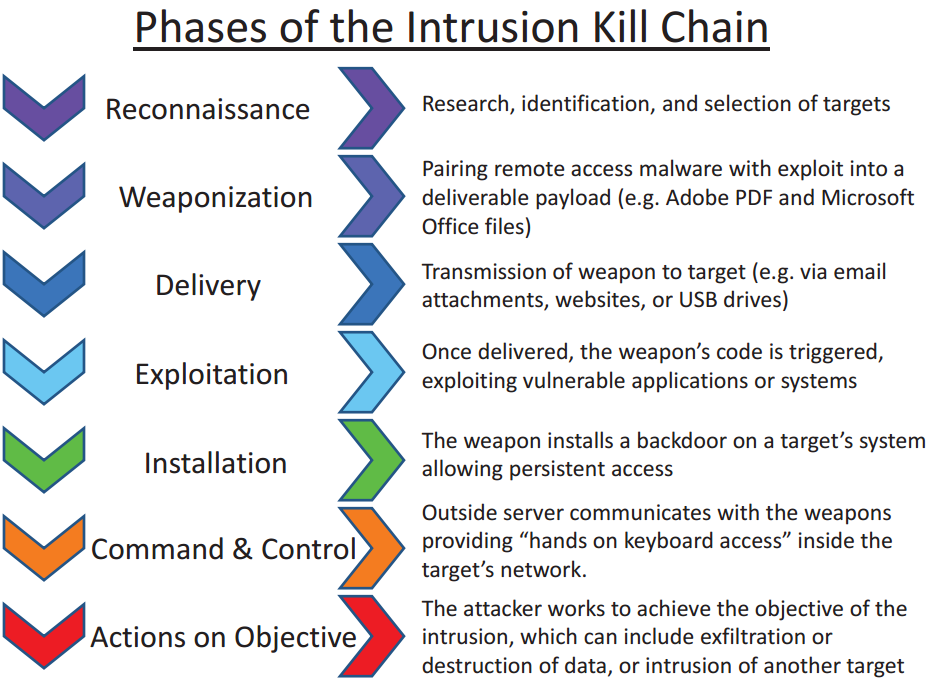

## Eguna/ordua/tokia: 2026/XI/26 / 15:00 / Gelategiko 1.7 gela

<!--

-->

## Hizkuntza / Idioma 

Gaztelera / Castellano

## Modalitatea / Modalidad

Aurrez aurrekoa / Presencial

## Edukia / Contenido

**[EUS] Izenburua**: Haririk gabeko sistemetango bulnerabideak (+ RISC-V)

**[CAS] Título**: Vulnerabilidades en sistemas inalámbricos (+ RISC-V)

**[EUS]** Irrati-uhinak nonahi aurki ditzakegu mundu modernoan; nola, bere formarik klasikoenak diren irismen handiko eta ertaineko bandetan (irrati komertzialak, WiFi, Bluetooth), hala, bere irismen laburreko bertsioetan (ukipen gabeko txartelak, RFID etiketak etabar). Sistema digitalek uhin horiek erabiltzen dituztenean, jabedun protokoloak erabili ohi dituzte zeintzuk euren konplexutasunean gerizatzen baitira sahiesteko ezen eraso baten jomuga izan ditezen. Dena dela, hitzaldi honetan ikusiko dugun bezala, estrategia horrek emaitza ustelak emango dizkie. 

**[CAS]** Las señales de radio son ubicuas en el mundo moderno; tanto en su forma más clásica de largo y medio alcance (radio comercial, WiFi, Bluetooth) como en su versión de muy corto alcance (tarjetas contactless, tags rfid, etc). Al ser utilizadas por sistemas digitales suelen emplear protocolos propietarios que se escudan en su complejidad para evitar ser objeto de ataque, como veremos en esta ponencia esta estrategia resulta ser infructuosa.

**[EUS]** Hitzaldi honetan zertzuk erakutsiko dira, irrati-uhinak nola interzeptatu, alderantzizkatze ingeniaritza aplikatuko diegu protokolo erabilienei, eta azkenik, euren ahulguneak aztertuko ditugu eta erabiliko ezen horiek darabiltzaten sistemak bulneratzeko.

**[CAS]** En esta ponencia se monstrará cómo interceptar ondas de radio, aplicaremos ingeniería inversa sobre los protocolos utilizados y finalmente analizaremos sus debilidades y las usaremos para vulnerar los sistemas que las utilizan.

<!--
## Izen-ematea / Inscripción

**[EUS]**

Izen-ematea debaldekoa da. Nahikoa da email bat bidaltzea hona: dif.ziur@ehu.eus. Gaia INSKRIPZIOA KILLCHAIN ipini eta gorputzean zure datuak (izena + abizenak). Epe muga: 2026-IV-21.

**[CAS]**

La inscripción es gratuita. Basta con que envíes un email a dif.ziur@ehu.eus. Tema INSCRIPCIÓN KILLCHAIN y con tus datos (nombre + apellidos) en el cuerpo del mensaje. Fecha límite: 21-IV-2026.
-->

## Hizlariak / Ponentes

**[EUS] Erik Cembreros**: Donostiako Informatika Fakultatean (EHU) Informatikan Ingeniaritza Gradua ikasi zuen; eta gaur egun Intelligent Systems Group (ISG) ikerketa-taldeko kide da.

**[CAS] Erik Cembreros**: Estudió Grado en Ingeniería Informática en la Facultad de Informática de Donostia (EHU); y hoy en día es miembro del grupo de investigación Intelligent Systems Group (ISG).

**[EUS] Martin Horsfield**: Donostiako Informatika Fakultatean (EHU) Informatikan Ingeniaritza Gradua ikasi zuen; eta gaur egun Intelligent Systems Group (ISG) ikerketa-taldeko kide da.

**[CAS] Martin Horsfield**: Estudió Grado en Ingeniería Informática en la Facultad de Informática de Donostia (EHU); y hoy en día es miembro del grupo de investigación Intelligent Systems Group (ISG).

**[EUS] Iker Galardi**: Donostiako Informatika Fakultatean (EHU) Informatikan Ingeniaritza Gradua ikasi zuen; eta gaur egun Intelligent Systems Group (ISG) ikerketa-taldeko kide da.

**[CAS] Iker Galardi**: Estudió Grado en Ingeniería Informática en la Facultad de Informática de Donostia (EHU); y hoy en día es miembro del grupo de investigación Intelligent Systems Group (ISG).
